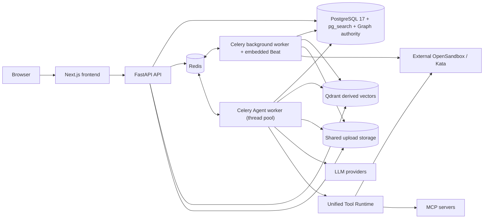
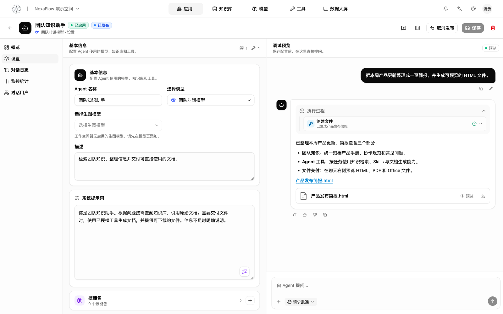
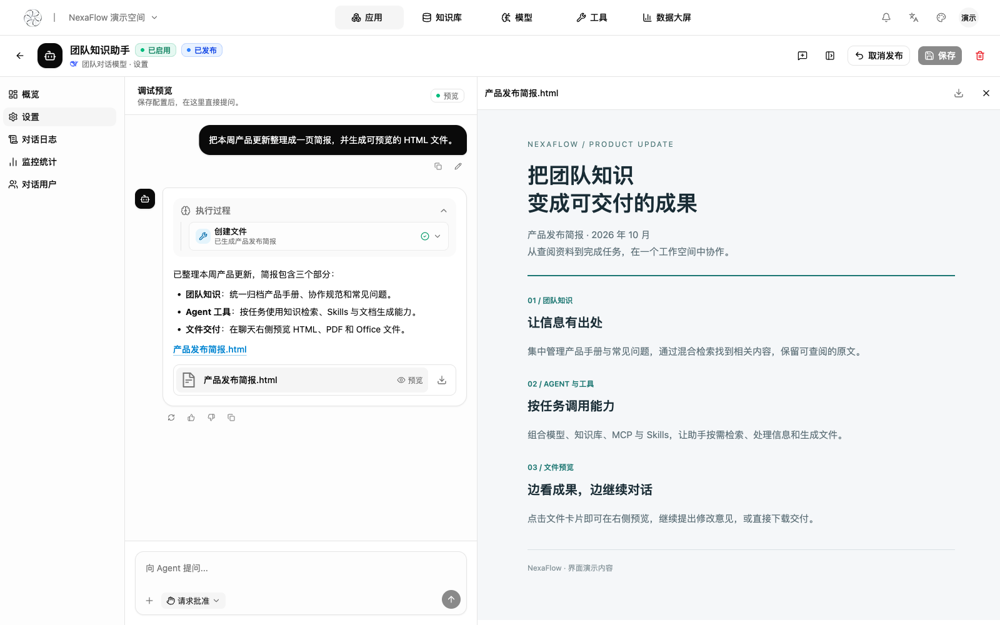
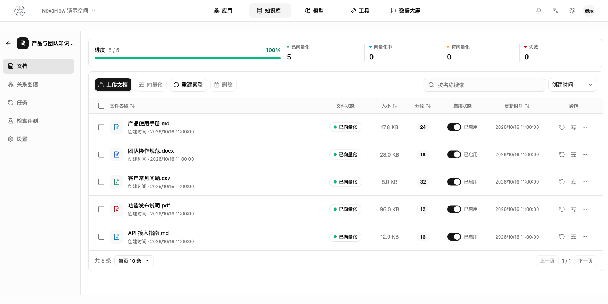
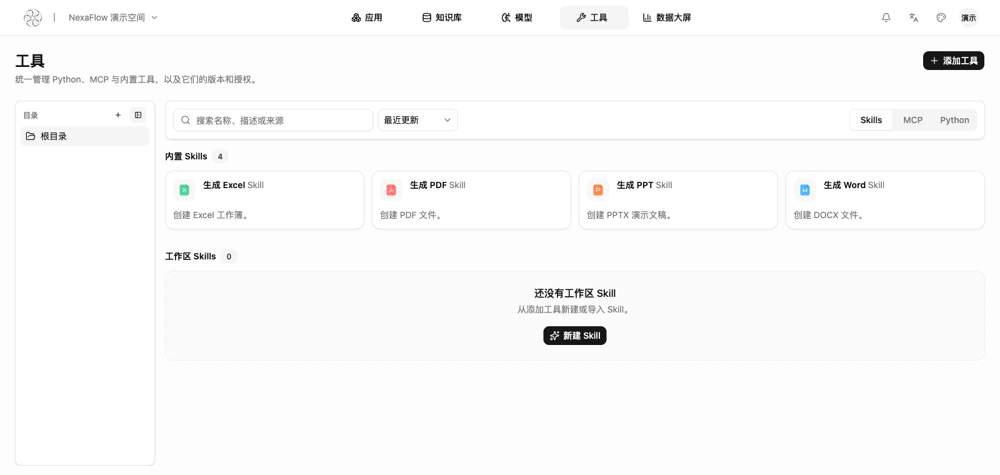
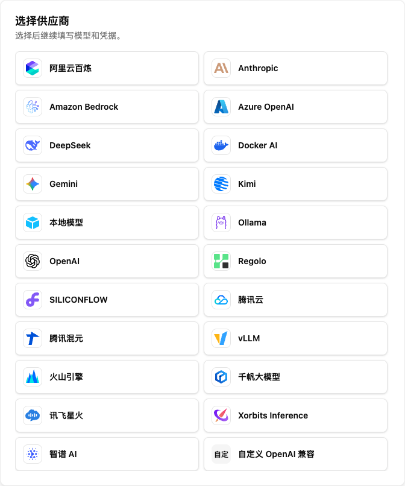
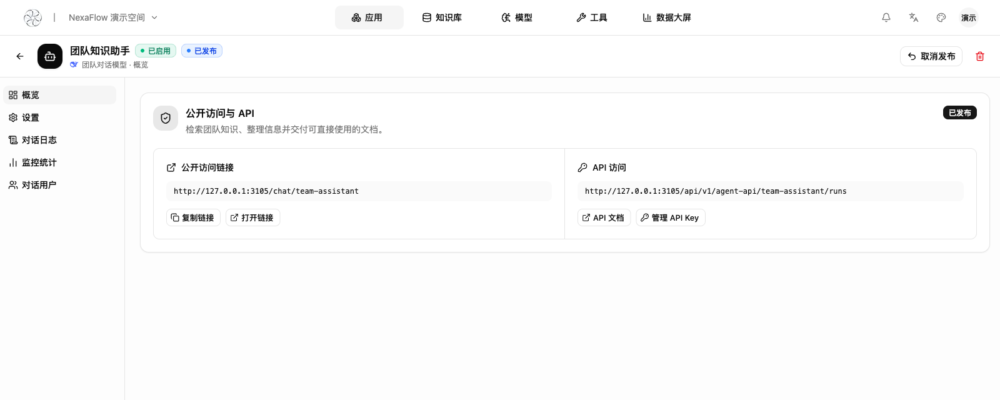
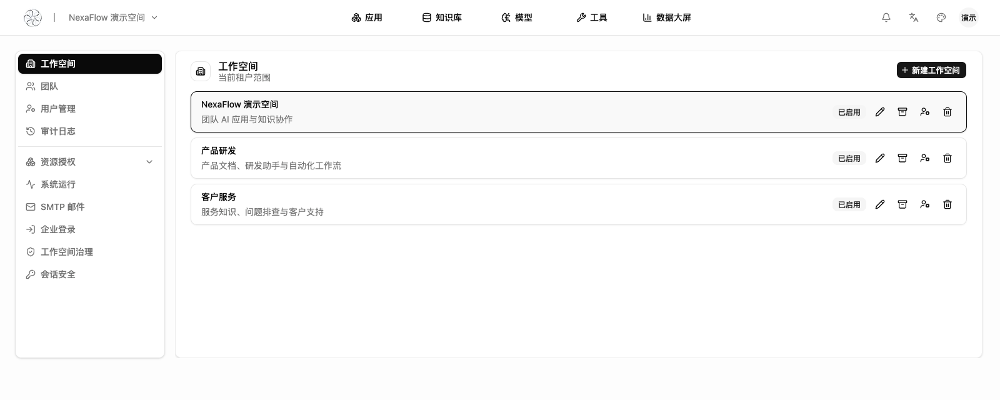

<div align="center">
  
  <h1>NexaFlow</h1>
  <p>面向团队的 AI 应用编排平台，将知识库、模型、Agent、工作流与统一工具能力组织在同一工作空间中。</p>

  <p>
    <a href="https://github.com/IQZZ020501/NexaFlow/actions/workflows/ci.yml"></a>
    
    
    <a href="https://coderabbit.ai"></a>
    <a href="LICENSE"></a>
  </p>
</div>

[核心能力](#核心能力) · [快速开始](#快速开始) · [创建第一个应用](#创建第一个应用) · [本地开发](#本地开发) · [文档导航](#文档导航) · [界面截图](#界面截图)

## 项目简介

NexaFlow 是面向团队的 AI 应用构建与运行平台，适合知识问答、资料整理、文档生成和业务流程编排。模型、知识库、Agent、工作流、MCP 与 Skills 在同一工作空间中管理，资源访问受工作空间和团队权限约束。

Agent 通过通用模型与工具循环完成任务，按需使用知识检索、MCP 和 Skills；工作流通过可视化画布定义执行顺序。两者共用持久运行、权限审批、工具调用记录与隔离执行能力，支持从控制台调试到发布访问页面和 API 接入。

## 核心能力

| 能力 | 说明 |
| --- | --- |
| 应用构建与发布 | 统一管理 Agent 和工作流，保留草稿与不可变发布版本，提供访问页面、独立 API Key 和接口文档。 |
| Agent 运行时 | 支持流式回答、对话记忆、上下文压缩、运行中追加输入、工具审批和模型用量记录；通过 Celery、租约、checkpoint 与事件恢复执行。新建 Run 默认具备在隔离环境中执行 bash 的能力。 |
| 知识库与 RAG | 支持文档与 QA 导入、智能层级分段、规范化 Markdown 预览、Qdrant 向量与 `pg_search` BM25 混合检索、RRF/可选重排、引用、证据图谱和检索评测。 |
| 可视化工作流 | React Flow 画布支持模型、知识检索、分类、条件、表单、变量、工具、Python 代码与已发布 Agent 等节点，提供草稿调试、版本管理和节点执行记录。 |
| MCP 与统一工具 | 内置、Python、MCP 工具共享版本、授权和调用账本。MCP 支持 Streamable HTTP、SSE 和 stdio；远程凭据与 stdio 配置加密保存。 |
| Skills | 导入 `SKILL.md` 或 ZIP 技能包，按需加载指令、参考文件和 Python/JavaScript 脚本；固定版本绑定到 Agent，脚本依赖安装需逐次审批。 |
| 文件与图片生成 | 内置 Word、PDF、Excel、PPTX 文件渲染工具，可按需接入生图模型；HTML、PDF、DOCX、XLSX、PPTX 在聊天右侧预览，查看文件时可以继续对话。 |
| 模型接入 | 当前提供 22 个供应商目录项，包括 OpenAI、Anthropic、Bedrock、Azure OpenAI、Gemini、DeepSeek、阿里云百炼、Kimi、Ollama、vLLM 和自定义 OpenAI 兼容服务；支持对话、视觉、向量、重排和生图模型，具体类型取决于供应商。 |
| 团队与管理 | 多工作空间、团队和资源级授权，审计日志、公告与消息中心、SMTP 邮件、企业登录及会话管理；界面支持简体中文、繁体中文、英文和多种外观设置。 |

### 使用边界

- **知识库上传**：接受 DOCX、MD、MARKDOWN、PDF、TXT、PPTX、XLSX、XLS、HTML、CSV、JSON、XML、ZIP。PDF 提取已有文本层，不做 OCR；扫描件需要先转成可提取文本的文档。QA 模式需主动选择，支持带问题/答案表头的 XLSX 和 UTF-8 CSV。
- **文件预览**：支持 HTML/HTM、PDF、DOCX、XLSX、PPTX；旧版 DOC、XLS、PPT 仅提供下载。生成文件单个不超过 5 MiB，保存和下载链接有效期最长 24 小时。复杂 Office 排版、图表和动画以下载后在原生应用中的效果为准。
- **应用访问**：已发布应用的访问页面仍要求登录并属于相应工作空间；其他系统通过应用专属 API Key 接入。
- **代码执行**：bash、Python 工具、Skill 脚本和文件渲染依赖独立 OpenSandbox 执行环境；服务不可用时执行失败，不回退到业务宿主机。

## 技术架构



| 层级 | 技术 |
| --- | --- |
| 前端 | Next.js 16、React 19、TypeScript、Bun、shadcn/ui、Tailwind CSS、React Flow |
| API | Python 3.11+、FastAPI、SQLAlchemy Async、Alembic |
| 异步执行 | Celery、Redis、PostgreSQL checkpoint 与事件 |
| 工具与 Skills | builtin / Python / MCP 统一目录、不可变版本、授权、策略、调用账本与按需加载的技能包 |
| 检索 | PostgreSQL（权威文档、证据图谱与 revision）+ Qdrant（可重建的文档/Profile 派生向量）、`pg_search` 0.25.2（Jieba/BM25）、RRF、引用扩展、有界多跳路径、可选 reranker；不需要 Neo4j 或新数据库 |
| 部署 | PostgreSQL 17 + `pg_search`、Docker Compose、Nginx、独立 OpenSandbox / Kata 执行主机（镜像以 digest 固定） |

## 快速开始

以下步骤适用于拉取镜像部署。需要在本机修改代码或体验完整开发环境时，可直接使用[本地开发](#本地开发)中的 `make dev`。

### 前置要求

- Docker 与 Docker Compose v2
- 已按[执行主机部署说明](deploy/opensandbox/README.md)配置、且 API/Worker 可访问的 OpenSandbox 服务；生产环境使用独立 Linux/Kata 执行主机和固定 digest 的执行镜像
- 已获取本仓库，并在仓库根目录执行后续命令

### 1. 准备配置

```bash
cp .env.example .env
```

编辑根目录 `.env`，至少替换以下值：

- `POSTGRES_PASSWORD`
- `BOOTSTRAP_ADMIN_PASSWORD`
- `MANAGED_USER_INITIAL_PASSWORD`
- `OPENSANDBOX_URL`、`OPENSANDBOX_API_KEY` 和 `OPENSANDBOX_IMAGE`（生产环境使用镜像 digest）

Compose 容器中的 `127.0.0.1` 指向容器自身，`OPENSANDBOX_URL` 必须填写容器可达的执行主机地址。执行镜像通过独立流程构建和部署，不包含在业务应用镜像内。

`JWT_SECRET_KEY` 与 `MODEL_SECRET_KEY` 不在 `.env.example` 中，也不需要写进 `.env`：
首次启动时会自动生成并保存到 PostgreSQL（`platform_secrets`），之后始终以数据库中
的值为准。只有需要由外部密钥管理提供初始密钥时才手动加入这两个变量，且只对空库
生效；已有的存储值不会被环境变量覆盖，因此改错或重写 `.env` 不会再让已保存的凭据
和会话失效。

生产环境不要继续使用示例文件中的凭据。本地服务地址、执行预算和令牌有效期
使用代码默认值；SMTP、企业身份、工作空间治理、模型和工具等可管理配置保存在
数据库中，不需要复制进 `.env`。公开 Origin 默认是 `http://localhost:8080`；使用
正式域名时通过 `PUBLIC_APP_URL` 覆盖。

### 2. 初始化并启动

```bash
docker compose --env-file .env -f deploy/docker-compose.server.yml up -d
```

`up -d` 会自动等待数据库、执行尚未应用的 Alembic 迁移，再启动 API、前端与 Worker（沙箱运行在独立 OpenSandbox 执行主机，不在本 Compose 内）。迁移复用应用镜像，不需要单独构建迁移镜像。
首次启动会自动拉取缺失镜像；升级已有部署时先执行 `pull`，再执行同一条 `up -d`。

启动完成后通过唯一对外端口访问：

- Web：<http://localhost:8080>
- API 健康检查：<http://localhost:8080/health>
- OpenAPI：<http://localhost:8080/docs>

生产 Compose 默认只发布宿主机 `8080` 端口，可用 `NEXAFLOW_PORT` 覆盖；其余服务仅在内部网络访问。自定义镜像、外部数据库和 Nginx 配置见 [`docs/DEPLOYMENT.md`](docs/DEPLOYMENT.md)。

使用根目录 `.env` 中的 `BOOTSTRAP_ADMIN_USERNAME` 和 `BOOTSTRAP_ADMIN_PASSWORD` 登录。首次登录必须修改初始密码。

### 3. 查看状态与日志

```bash
docker compose --env-file .env -f deploy/docker-compose.server.yml ps
docker compose --env-file .env -f deploy/docker-compose.server.yml logs -f api worker agent-worker frontend
```

`worker` 处理知识库、工具测试、邮件和清理任务，并内嵌唯一的 Beat，只能运行一个实例；`agent-worker` 专门执行 Agent 与工作流对话，单进程用线程池并发处理（默认 32 个），对话量大时可以横向扩容：

```bash
docker compose --env-file .env -f deploy/docker-compose.server.yml up -d --scale agent-worker=2
```

停止服务：

```bash
docker compose --env-file .env -f deploy/docker-compose.server.yml down
```

数据保存在 `deploy/data` 的 bind mount 中，`down` 不会删除它。如需重置本地数据，必须先停止相关容器；不要在 Redis、PostgreSQL 或 Qdrant 运行时删除其挂载目录。

详细的部署、迁移、Nginx 和安全配置见 [docs/DEPLOYMENT.md](docs/DEPLOYMENT.md)。

## 创建第一个应用

1. **登录并进入工作空间**：使用根目录 `.env` 中的引导账号登录，首次登录修改密码，再选择或创建工作空间。
2. **接入模型**：在「模型」页添加对话模型并检查连接；需要知识检索时再接入向量模型，需要图片生成时再接入生图模型。
3. **准备知识与工具**：按任务需要创建知识库、上传文档并等待向量化完成；在「工具」页配置 MCP、Python 或导入 Skills，并为使用者授予相应权限。
4. **创建并调试**：在「应用」页创建 Agent，选择模型、填写系统提示词并按需关联知识库、工具与 Skills，在右侧调试区验证。需要固定执行流程时，创建工作流并在画布中连接节点。
5. **发布与交付**：发布后从「概览」获取访问链接或 API 文档。生成的文件可以直接下载；支持的格式可点击文件卡片，在右侧预览并继续对话。

## 本地开发

本地开发需要 Docker Compose v2、Python 3.11+、[uv](https://docs.astral.sh/uv/)、Bun 1.3+ 和 GNU Make。macOS 与 Linux 直接在仓库根目录运行：

```bash
make dev
```

首次运行会自动创建私有 `.env`、生成缺失的本地密钥、同步后端/前端依赖、构建 PostgreSQL 与执行镜像、生成普通 Docker 的 OpenSandbox 开发配置、启动 PostgreSQL/Redis/Qdrant，并应用 Alembic 迁移。后续启动仅在对应镜像不存在或构建输入变化时重新构建；需要显式重跑镜像构建时使用 `make dev-rebuild`。随后由同一终端统一托管 OpenSandbox、API、Celery Worker 与前端，日志带进程前缀。开发配置保存在 `~/.local/share/nexaflow-opensandbox`，不会覆盖已有配置。

启动完成后访问 <http://localhost:3000>；API 健康检查和文档分别位于 <http://localhost:8000/health> 与 <http://localhost:8000/docs>。按 `Ctrl+C` 会停止本次托管的 OpenSandbox、API、Worker 和前端，但保留基础容器及数据，便于下次快速启动。若 OpenSandbox 已在运行且密钥匹配，启动器会直接复用。

默认端口被其他开发进程占用时，可用一次性的 `NEXAFLOW_DEV_API_PORT=8001 NEXAFLOW_DEV_FRONTEND_PORT=3001 make dev` 启动；前端代理会自动指向对应 API 端口。

`bun run dev` 和 `bun run build` 会自动构建 PDF/Office 预览所需的本地静态资源。开发期间只修改文件预览器时，在 `frontend/` 运行 `bun run build:file-preview` 刷新资源。

本地 `--development` OpenSandbox 使用普通 Docker，只用于功能开发，不代表生产级隔离；生产仍须使用独立 Linux/Kata 执行主机。原生 Windows 不支持，请在 WSL2 中运行。需要单独调试 API 或 Worker 时，仍可分别使用 `cd backend && make dev` 和 `cd backend && make worker`。

## 仓库结构

```text
NexaFlow/
├── backend/    FastAPI API、服务、能力适配器、Celery 与 Alembic
├── frontend/   Next.js App Router、页面组件、API 客户端与三语词典
├── sandbox/    OpenSandbox 独立执行镜像、任务协议与固定文件渲染器
├── deploy/     Docker Compose、Dockerfile 与 Nginx 示例
├── docs/       模块、产品与工程文档
├── scripts/    仓库辅助脚本
└── .github/     CI 工作流（Compose 校验与前后端套件）
```

后端依赖方向和模块索引见 [docs/INDEX.md](docs/INDEX.md)，运行时与部署细节见 [backend/README.md](backend/README.md) 和 [docs/DEPLOYMENT.md](docs/DEPLOYMENT.md)。

## 文档导航

| 需要了解 | 文档 |
| --- | --- |
| 模块职责与代码入口 | [文档索引](docs/INDEX.md) |
| 业务服务部署、配置与数据存储 | [部署说明](docs/DEPLOYMENT.md) |
| 独立执行主机、镜像与网络策略 | [OpenSandbox 部署](deploy/opensandbox/README.md) |
| Agent 运行、持久化与恢复 | [Agent 运行时](docs/AGENTS_RUNTIME.md) |
| 知识导入、检索、证据图谱与评测 | [知识库](docs/KNOWLEDGE.md) |
| 工作流节点与执行语义 | [工作流设计](docs/WORKFLOW_DESIGN.md) |
| 技能包格式、授权与脚本执行 | [Skills](docs/SKILLS.md) |
| 模型供应商与适配方式 | [模型接入矩阵](docs/model-providers.md) |
| 飞书、钉钉、企业微信登录 | [企业身份接入](docs/ENTERPRISE_IDENTITY.md) |
| 前端路由、交互与文件预览 | [前端模块](docs/FRONTEND.md) |

## 测试

后端（套件按功能分包，模块名形如 `tests.<feature>.<module>`；完整清单见 `AGENTS.md`）：

```bash
cd backend
uv run python -m compileall -q app tests
uv run python -m tests.smoke.test_main
uv run python -m tests.knowledge.knowledge
uv run python -m tests.knowledge.unit
uv run python -m tests.agents.agents
uv run python -m tests.agents.unit
uv run python -m tests.workflows.workflows
uv run python -m tests.tools.tools
uv run python -m tests.infra.architecture
```

后端完整覆盖率 gate（97%）：

```bash
cd backend
COVERAGE_JOBS=1 make coverage
```

前端：

```bash
cd frontend
bun run typecheck
bun run lint
bun test --parallel
bun run build
```

沙箱：

```bash
uv run --project sandbox python -m sandbox.tests
bash sandbox/run_coverage.sh
make sandbox-image
docker run --rm --network none --read-only --user 65532:65532 \
  --cap-drop ALL --security-opt no-new-privileges:true --memory 512m --pids-limit 96 \
  --tmpfs /tmp:rw,nosuid,nodev,size=64m,mode=1777 \
  --entrypoint /opt/nexaflow/.venv/bin/python \
  ${OPENSANDBOX_IMAGE:-nexaflow/execution:local} -I /opt/nexaflow/self_check.py
```

执行镜像自检及真实 OpenSandbox 检查见 [部署说明](deploy/opensandbox/README.md)。
根目录开发监督器 `scripts/dev.py` 的单元测试单独运行：`uv run python scripts/dev_test.py`（不在 CI 覆盖率范围内）。
完整 CI 套件以 [.github/workflows/ci.yml](.github/workflows/ci.yml) 为准。

## 安全说明

- API 与内嵌 Beat 的 Worker 必须连接同一 PostgreSQL、Redis、Qdrant，并共享上传存储和加密密钥；不要同时运行第二个 Beat。
- 远程 MCP 默认拒绝私网与回环地址；只有明确可信的部署才应启用 `MCP_ALLOW_PRIVATE_NETWORKS`。
- stdio MCP 在独立 OpenSandbox 内运行；command/cwd 是执行镜像路径，不能读取业务宿主目录。仅注入该集成的环境值，出站域名须由部署 allowlist 批准。
- Python Tool、Python Code、文件渲染与 Skill 脚本通过统一 execution port 执行；业务 Worker 无 Docker socket、namespace 特权或本地运行器回退。
- HTML 与 Office/PDF 预览在不透明源的 sandbox iframe 中运行；渲染器使用本地静态资源，不向第三方预览服务发送文件或下载凭据。
- 生产执行平面使用 Kata + `dns+nft`、持久化元数据与不可变镜像 digest；网络策略不满足要求时失败关闭。开发 Docker 测试不能替代生产 VM 隔离验收。
- 不要提交根目录 `.env`、模型凭据或其他真实密钥。

## 贡献

`main` 分支受保护，变更通过 Pull Request 合入。提交信息和 PR 标题使用 Conventional Commits：

```text
<type>(<scope>): <summary>
```

开始贡献前请阅读 [AGENTS.md](AGENTS.md)，并确保受影响模块的最小测试、静态检查和构建检查通过。

## 许可证

本项目基于 [GNU General Public License v3.0](LICENSE) 发布。内置数据库镜像使用的 `pg_search` Community 扩展采用 AGPLv3，第三方组件仍保留各自许可条款；部署前请查阅 [docs/DEPLOYMENT.md](docs/DEPLOYMENT.md)。

## 界面截图

以下截图于 **2026-10-16** 从当前前端代码运行的桌面界面截取，使用本地演示数据。示例会话与文件内容用于展示交互，未调用真实模型；不包含真实业务数据或 API Key。

### Agent 构建与调试

配置模型、提示词、知识库、工具和 Skills，并在同一页面查看对话与工具执行过程。



### 对话中的文件预览

点击文件卡片后，右侧显示预览，左侧仍可继续输入。下图展示 HTML 简报；PDF、Word、Excel 和 PPTX 共用文件预览面板。



### 知识库文档管理

集中查看文档、分段数量和向量化状态，并进入关系图谱、后台任务、检索评测与设置。



### Skills 与工具

工具页统一提供 Skills、MCP 和 Python 入口；内置 Skills 可生成 Word、PDF、Excel 和 PPTX，也可新建或导入工作区技能包。



### 模型供应商

按供应商选择模型接入方式，再填写模型标识、连接地址与凭据；完整支持范围见[模型接入矩阵](docs/model-providers.md)。



### 应用发布与 API

在应用概览中获取访问链接、打开接口文档并管理独立 API Key。截图中的地址仅为本地演示地址。



### 工作空间管理

按团队或业务场景划分工作空间，管理成员、资源授权和审计，并从系统管理入口配置企业登录、邮件与会话安全。


