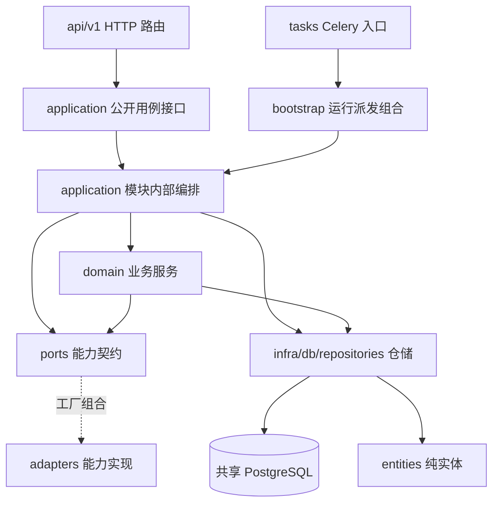

# 分层模块化单体

NexaFlow 采用分层模块化单体（Layered Modular Monolith）：按业务职责划分模块，在同一个后端产品中通过 Python 接口协作，共用 PostgreSQL、事务和发布版本。前端继续独立使用 Next.js；API、后台 Worker 和 Agent Worker 是同一产品的不同执行进程。Redis、Qdrant 和 OpenSandbox 提供基础能力，容器数量不代表业务微服务数量。

## 代码组织与调用方向

保留 `app/<技术层>/<业务特性>/` 的现有目录。模块边界由公开接口、允许的依赖和自动检查约束。



- `api/` 处理 HTTP、请求校验和依赖，调用公开用例；现存的直达领域或基础设施调用仍按原有规则逐步收敛。
- `application/` 编排用例。跨特性调用必须使用登记的公开接口及其 `__all__`，并在依赖表中声明。
- `domain/` 保存业务规则和领域服务。各领域之间可以协作，领域层特性依赖必须无环；不能反向引用应用层、HTTP 路由、任务入口或具体适配器。
- `entities/` 保存不依赖框架的 dataclass；`schemas/` 保存 Pydantic 请求和响应契约。
- `infra/db/repositories/` 负责 ORM 与实体映射、持久化操作；用例和领域服务协调现有 `AsyncSession` 事务。ORM 仍保留在各领域的 models 文件。
- `ports/` 定义可替换能力；适配器工厂保留函数内组合。统一 Tool 的值对象与协议位于 `ports/tools.py`，Run 入队能力位于 `ports/runs.py`。
- `bootstrap/runs.py` 组合 Agent 与 Workflow 的执行器；任务入口调用它，用例通过入队端口发布任务。既有队列名、任务名、eager 执行和恢复语义保持一致。

这套约束覆盖用例公开边界、技术分层及应用层和领域层各自的循环依赖。领域服务仍沿用现有 FastAPI 异常、schemas 和仓储调用方式；数据库也仍由产品统一管理，没有逐模块私有数据库或独立部署约定。

## 模块职责

公开入口和允许的依赖以 `backend/scripts/module_boundaries.py` 为准；各入口的静态 `__all__` 是可被 HTTP 和其他应用模块使用的名称。

| 模块 | 职责 / 主要公开入口（相对于 `app/application/`） |
| --- | --- |
| agents | Agent 管理与执行；`agents/__init__.py`、`agents/integration.py`、`agents/runs/session.py` |
| workflows | Workflow 定义、版本与运行；`workflows/definitions/service.py` 用例门面 |
| tools | 工具目录、策略与统一调用账本；`tools/__init__.py`、`tools/runtime/service.py` 等 |
| agent_skills | Skill 包、固定版本加载、脚本与依赖安装；`agent_skills/__init__.py` 及专门的能力入口 |
| knowledge | 知识库和文档生命周期、检索；`knowledge/{documents,retrieval}/service.py` |
| projects | 项目文件及运行时工作区；`projects/{service,runtime}.py` |
| artifacts | 生成物存储、授权下载、工作区文件；`artifacts/{service,workspace}.py` |
| models | 注册模型与配置管理；`models/service.py` |
| identity | 用户、登录、会话、邀请、找回密码、企业身份；`identity/` 各用例服务 |
| workspaces / teams | 工作空间上下文、成员与团队；`workspaces/service.py`、`teams/__init__.py` |
| governance | 配额、治理设置与健康检查；`governance/service.py` |
| resource_folders | 资源文件夹；`resource_folders/service.py` |
| announcements | 公告、消息和通知流；`announcements/__init__.py` |
| audit / analytics | 审计、系统日志和使用分析；各模块门面及 `audit/system_logs.py` |
| email | SMTP 配置及可恢复邮件投递；`email/{smtp,delivery}.py` |
| publications | 共用的发布上下文、发布者有效性和工作空间成员校验；`publications/service.py` |
| uploads | 共用的临时上传、解析和访问控制；`uploads/service.py` |
| runs | 共享 Run 取消、反馈和租约心跳；`runs/{lifecycle,feedback,leases}.py` |

共享职责有明确的归属：

- Workflow 调用 Agent 使用 `agents/integration.py`，不导入 Agent 执行器和工具构建器的内部文件。
- 发布访问和生成物下载通过 `publications` 解析发布上下文，上传归 `uploads`，避免基础模块反向依赖 Agent / Workflow 的用例实现。
- 模型配置指纹归 `domain/models/runtime.py`；已授权 Skill 目录文本归 `domain/agent_skills/catalog.py`。
- 应用创建与 Workflow 编辑共用的默认图及规范化哈希归 `domain/applications/definitions.py`，无需装载 Workflow 执行引擎。
- 上传持久清理归 `domain/uploads/service.py`；原有 `workflow_uploads` 数据表、清理意图和 Beat 恢复链保持兼容。

## 开发与检查

新增业务特性时，沿用现有分层目录和仓储模式，登记公开接口与允许依赖。已有模块增加公开函数时，把它加入对应入口的 `__all__`；实现细节留在模块内部。共享职责应归属到实际拥有它的模块。

在 `backend/` 运行：

```bash
uv run python -m tests.infra.architecture
uv run python scripts/dependency_matrix.py --check
uv run python scripts/dependency_matrix.py --json /tmp/nexaflow-dependencies.json
```

架构套件已由现有 CI 执行，检查内容包括：

1. 分层依赖、纯实体的框架隔离，以及精确列出的既有模型供应商组合例外。
2. HTTP 和应用模块对其他应用模块的公开入口、导出名称及依赖声明；禁止通配导入绕过边界。
3. 应用层特性之间、领域层特性之间各自的循环依赖。
4. 公开入口可以导入、导出名称实际存在、新应用模块已登记。
5. 分析器回归：完整路径、相对导入、函数内导入、字面量动态导入、模块别名和语法错误。`TYPE_CHECKING` 导入不计为运行时依赖。

这是静态检查，不推断通过反射或计算字符串构造的动态调用。任务入口和 bootstrap 可以组合内部执行器；端口工厂的延迟适配器导入及 Run 派发委托是明确的组合点，不构成业务模块通用例外。

改动对应业务后，还应运行相应的 `tests.<feature>.<suite>` 回归。模块整理不改变租户隔离、授权、不可变快照、统一 Tool 账本、Run 租约和清理恢复约束；涉及这些行为时使用已有端到端测试验证。
